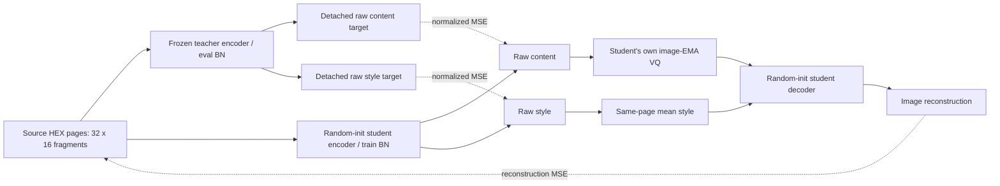

# RD-V3: source representation distillation

Registered 2026-11-20 (Asia/Dubai). Research name: **Inductive Bias
Internalization (IBI)**. RD-V3 means Representation-Distilled V3. The canonical
question and interpretation are in [V5 RQ6](../../v5/research/directions/RQ6_INDUCTIVE_BIAS_PERSISTENCE.md).
This source-stage experiment is not OOD fine-tuning or an IBI success result.

## Data and gradient flow



All labels are diagnostics only. Teacher targets are computed on the SAME
source image as the student. Teacher is permanently eval/no-grad, with frozen
BN/VQ. The teacher decoder never participates in the objective. The student
encoder and decoder are independently initialized; its K16 codebook has its
own first-batch KMeans/EMA state. No teacher parameter or codebook row is copied.
Model architecture includes the teacher's page-mean decoder style input. This
is NOT an organization-removal experiment: source pages remain same-style.

Let `zc` denote raw pre-VQ content, `zs` raw per-fragment style, `T` teacher,
`S` student. Define fixed scale constants on 2048 source TRAIN pages:

```text
Vc = mean_j Var_train[zc_T[..., j]]
Vs = mean_j Var_train[zs_T[..., j]]
Lc = mean((zc_S - stopgrad(zc_T))^2) / max(Vc, 1e-8)
Ls = mean((zs_S - stopgrad(zs_T))^2) / max(Vs, 1e-8)
Ltotal = Lrecon + 0.1 Lcommit + 1.0 Lc + 1.0 Ls
```

Calibration uses a fixed local RNG and preserves the training RNG stream.
Targets are not centered or whitened; only scalar loss scales are normalized.
Raw MSE is also recorded. The teacher's raw style, not page-mean style, is the
supervision target. Reconstruction uses the student's own quantized content
and its own page-mean style. There is no teacher forcing into the decoder.

Original V3 content/style/sample/fragment terms and ratios are computed under
no-grad, reported in the original columns, and marked diagnostic-only in
plots. They and the teacher's rank regularizer contribute ZERO gradient. The
student remains an ordinary V3-compatible checkpoint for later fine-tuning.

## Configuration reference

Existing model, optimizer, data, diagnostic and checkpoint switches retain
their VVI meanings. New top-level `representation_distillation` fields:

| Field | Default / registered value | Meaning |
|---|---|---|
| `enabled` | false / true | Enable RD-V3 objective; disabled leaves original training unchanged. |
| `teacher_config` | required | Teacher resolved YAML; model architecture and source dataset must match. |
| `teacher_checkpoint` | required | Frozen teacher model state, never a student resume checkpoint. |
| `teacher_sha256` | required | Pin exact teacher weights; mismatch aborts. |
| `content_weight` | 1 | Multiplier of normalized pre-VQ content MSE; positive, finite. |
| `style_weight` | 1 | Multiplier of normalized raw style MSE; positive, finite. |
| `calibration_pages` | 2048 | Distinct source-train pages for scalar variance estimation; >=2. |
| `calibration_seed` | 20261120 | Local page subset seed, independent of training RNG. |
| `variance_floor` | 1e-8 | Positive lower bound on each normalization variance. |

`loss_config.weights` must set the four V3 terms to0; nonzero `v3_loss`,
rank regularization, objective schedules and checkpoint transforms are
rejected. `load_checkpoint` is only for a verified RD-V3 continuation, not
teacher initialization. Resumes and offline health evaluation load exact saved
calibration/protocol; they must not recalibrate on validation/test. Protocol
changes during resume are rejected. Optimizer LR follows existing VVI resume
semantics (restored moments/scheduler), not a silent fine-tuning LR override.

## Metrics and checkpoint selection

Same complete source validation, mapping implementation, page-disjoint leakage
probes, color diagnostics, original BN diagnostics, and reconstruction grids as
the teacher. Recompute Hungarian/majority maps on each current validation;
student/teacher code NUMBERS need not align. Only comparisons of aligned
semantics and embedding geometry are meaningful for independent codebooks.

New loss-history/plot columns:

- `distill_content_mse`, `distill_style_mse`: raw embedding regression errors.
- `distill_content_nmse`, `distill_style_nmse`: errors divided by fixed train variance.
- `weighted_distill_content_loss`, `weighted_distill_style_loss`: actual weighted terms.
- `weighted_recon_commit_loss`: weighted recon plus commitment; these three
  weighted columns sum exactly to `total_loss`.
- `distill_vq_vector_mse`: detached student's actual quantized vector versus
  teacher's quantized vector. A diagnostic, not another gradient route.
- `distill_teacher_cell_agreement`: quantize student raw content using the
  FROZEN teacher VQ and compare with teacher assignments. It diagnoses encoder
  geometry; it is NOT the student's own-VQ recognition or a semantic accuracy.

Keep current, health-gated macro-best and independent best validation TOTAL
RD objective, at most3 checkpoints. Primary student selection uses the latter;
source labels only diagnose eligibility for later matched OOD experiments.
Validation VQ commitment is zero under the existing library's eval behavior;
this is shared with original V3, not an empirical commitment disappearance.
RD total loss is not numerically comparable with original V3 total loss;
compare recon, semantics, leakage and matched constituent metrics instead.

## Registered first pair

Teacher: `logs/20261008-1623__VVI-HEX-K16-MEAN-RANK2-S0/cp_best_macro_atom_purity_epoch59.pt`.
SHA256: `0dd986ed363a266653de7e7e4e73c85d0730161d4039fd68d918f5e1c1a636a9`.
Same architecture C/S512,K16, encoder/decoder BN, page-mean decoding. This
teacher is semantically healthy but is not claimed perfectly disentangled:
report its source color and leakage alongside student metrics.

Two scratch seed0 runs differ ONLY in initial LR:1e-4 versus3e-4. AdamW WD.1,
exp decay.98/20epochs, floorfactor.02, batch32pages=512images, workers4.
200 natural source epochs = 500000 updates on80000 train pages. This is a
source-pretraining budget, not the10k OOD fine-tuning budget. Full10000page
validation every epoch; recon/confusion every10completed epochs and selected
early milestones; all scalar plots each epoch. Test/OOD remain sealed.

Provisional student readiness (evaluate both selected and current): Hungarian
and weighted purity >=.99,16active,ppl>=15; recon no more than1.25x audited
teacher; inspect per-style errors and both leakage directions (no more than
.05 accuracy degradation as an initial screening tolerance). These are
readiness diagnostics, not automatic permission to start OOD fine-tuning.
NMSE should be small, but no posthoc threshold will redefine success. If source
representation is not matched, do not interpret worse OOD transfer as failed IBI.

The initial pair comprises two source students. Recon-only pretraining is a deferred
baseline/constraint ablation, not assumed to fail and not launched. No arithmetic.

## Short source-age replica (2026-11-21)

User authorized one LR1e-4 replica plus matched V5 transfer at four fixed ages.
`cfg_rd_v3_hex_rank2_lr1e4_seed0_50e.yaml` changes only the run name, budget
(`epochs: 50`) and `snapshot_epochs: [0, 4, 19, 49]` from the initial source arm.
`snapshot_epochs` defaults to `[]`; entries are zero-based absolute epochs,
unique nonnegative integers. It unions with `snapshot_every_n_epochs` (default0).
The resulting `cp_snapshot_epoch*.pt` files survive current/best rotation.
Epoch0 means2500optimizer updates, not an untrained model.

Submission accepts optional `VVI_DEPENDENCY` (SLURM dependency string) and
`VVI_JOB_SCRIPT` (default `slurm/train.sbatch`). The registered source-age job
uses V5's `run_rd_source_campaign_slurm.sh`, which calls the original VVI
training wrapper unchanged and submits three V5 jobs on each atomic snapshot.
The complete campaign, exact matched templates, and live receipt are owned by
[V5 RQ6](../../v5/research/directions/RQ6_INDUCTIVE_BIAS_PERSISTENCE.md).

## Implementation and execution

- `model/distillation_loss.py`: validated teacher loading, calibration, objective.
- `trainer.py`: existing training/eval/checkpoint lifecycle, opt-in loss factory.
- `run_codebook_health.py`: same RD objective/calibration when auditing a student.
- `scripts/smoke_rd_v3.py`: full teacher-val audit, both CUDA arms, checkpoint
  reload/resume, immutable teacher checks; temporary smoke directories removed.
- `tests/test_representation_distillation.py`: loss algebra, gradient isolation,
  calibration/label independence and invalid-option tests.

Run all Python through SLURM, never login. Formal launch:

```bash
VVI_TIME=24:00:00 VVI_PYTHON=/home/xuanjie.liu/.venvs/v3_audio/bin/python \
  bash scripts/submit_slurm.sh \
  configs/hex/rd/cfg_rd_v3_hex_rank2_lr1e4_seed0.yaml \
  <YYYYMMDD-HHMM__run_name> <registered-run-id>
```

The environment is reused for dependencies; the task is image-only. Full code
and config provenance is captured by the standard SLURM submission wrapper.
